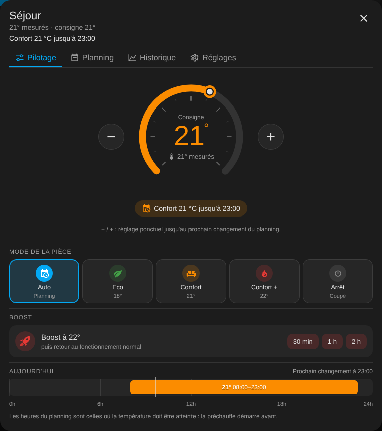
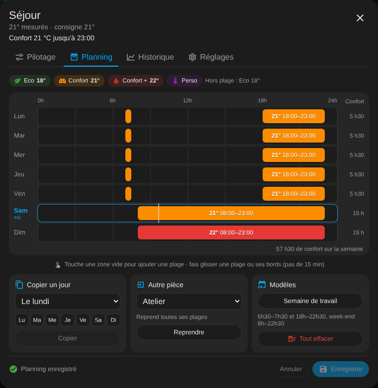

# Chauffage intelligent

Intégration Home Assistant pour piloter un chauffage multizone (pensée pour une PAC gainable **Koolnova**, compatible avec toute entité `climate`) avec :

- **un thermostat par pièce** (`climate.<pièce>`) et une page appareil complète ;
- **des plannings hebdomadaires visuels**, avec une consigne par plage (Eco, Confort, Confort +, ou température personnalisée) ;
- **une préchauffe progressive** : les heures du planning sont celles où la température doit être *atteinte*. La consigne monte par paliers de 0,5 °C avant la plage, plus tôt quand il fait froid dehors. La vitesse de chauffe de chaque pièce **s'apprend toute seule** (mesurée à chaque préchauffe, lissée sur les 7 dernières mesures) ;
- **des modes maison** : Auto, Absence (automatique quand plus personne n'est là, désactivable), Vacances (avec date de retour et préchauffe pour l'arrivée), Arrêt ;
- **la coupure fenêtre** (délai réglable par pièce, notification) ;
- **le boost** et les **réglages ponctuels** (valables jusqu'au prochain changement du planning) ;
- **un envoi fiable** : chaque consigne est vérifiée puis renvoyée si le Koolnova ne l'a pas prise (notification après plusieurs échecs) ;
- **la prise en compte des réglages faits sur le thermostat Koolnova** : ils deviennent un réglage manuel temporaire au lieu d'être écrasés.

La ventilation du Koolnova n'est jamais modifiée : seules la consigne et la mise en marche/arrêt sont envoyées.


## Installation (HACS)

Chaque nouvelle version est publiée automatiquement comme release GitHub : HACS la propose aussitôt (voir [CHANGELOG.md](CHANGELOG.md)).


1. HACS → menu ⋮ → **Dépôts personnalisés** → ajouter l'URL de ce dépôt, catégorie **Intégration**.
2. Installer **Chauffage intelligent**, puis redémarrer Home Assistant.
3. Paramètres → Appareils et services → **Ajouter une intégration** → *Chauffage intelligent*.

## Configuration

- **Réglages généraux** (bouton *Configurer*) : météo ou sonde extérieure, personnes pour l'absence automatique, téléphones à notifier, délais.
- **Pièces** (bouton *Ajouter une pièce*) : nom, zone Koolnova, capteurs de fenêtre, délai de coupure, type de pièce.
- **Consignes, planning, mode** : sur la carte ou sur la page de l'appareil de chaque pièce.

## Carte

La carte est chargée automatiquement par l'intégration : aucune ressource à déclarer.
Dans un tableau de bord : *Ajouter une carte* → **Chauffage intelligent**, ou en YAML :

```yaml
type: custom:chauffage-intelligent-card
title: Chauffage
# show_global: true   # mode maison et puces d'état
# group: true         # pièces principales / peu utilisées
# zones: [climate.sejour, climate.chambre_1]   # vide = toutes
```

Toucher une pièce ouvre sa fenêtre de réglage, en quatre onglets.

| Pilotage | Planning |
|---|---|
|  |  |
| **Cadran de thermostat** (consigne, mesure, − / + pour un réglage ponctuel), mode de la pièce en vignettes avec leur valeur, boost avec temps restant, planning du jour. | **Éditeur de la semaine** : touche une zone vide pour ajouter une plage, fais glisser une plage ou ses bords. Temps de confort par jour et par semaine, copie de jours, reprise du planning d'une autre pièce, modèles. |

| Historique | Réglages |
|---|---|
|  |  |
| **Chiffres clés** (chauffe du jour et de la période, température moyenne, temps à la consigne), courbe mesure / consigne sur 24 h ou 7 jours, temps de chauffe par jour. | **Consignes** sur une échelle colorée, préchauffe avec vitesse apprise et détail de la dernière mesure, état de la pièce (synchronisation, fenêtres). |

La carte suit le thème clair ou sombre de Home Assistant :


*Captures réalisées avec des pièces et des données de démonstration.*

## Ordre de priorité

1. Fenêtre ouverte depuis plus que le délai → arrêt
2. Maison en Arrêt, ou pièce en Arrêt → arrêt
3. Boost
4. Réglage ponctuel (jusqu'au prochain changement du planning)
5. Vacances → consigne vacances, puis préchauffe pour la date de retour
6. Absence → min(consigne absence, Eco). En Auto : préchauffe avant les plages, puis Confort pendant la première heure de chaque plage (arrivée prévue)
7. Pièce forcée en Eco, Confort ou Confort +
8. Auto : la plage en cours, sinon Eco avec la préchauffe vers la plage suivante

L'interrupteur **Moteur actif** permet de tout calculer sans rien envoyer (utile pour comparer avec un ancien système).

## Services

`chauffage_intelligent.set_planning`, `boost`, `cancel_boost`, `resume`, `set_zone_settings`, `set_zone_mode` (cible : le thermostat d'une pièce).

Format du planning :

```yaml
mon:
  - {start: "07:00", end: "07:30", preset: comfort}
  - {start: "18:00", end: "23:00", preset: custom, temp: 20.5}
tue: []
```
